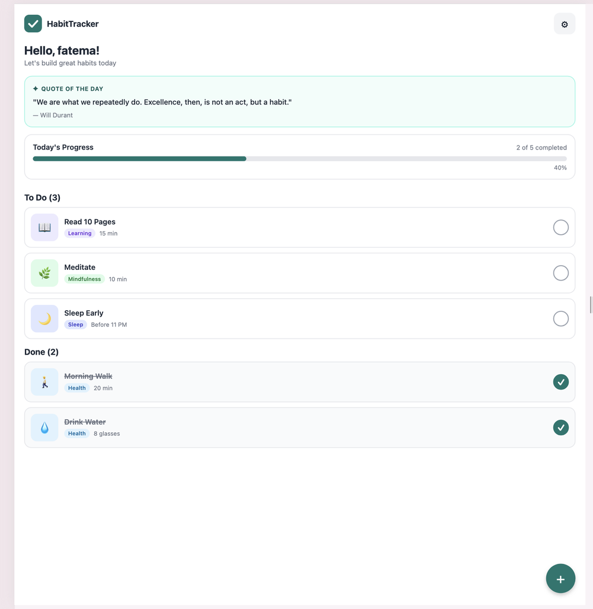
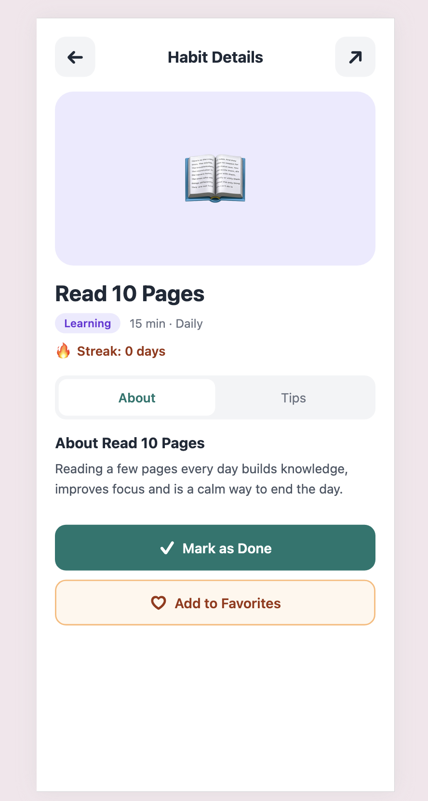
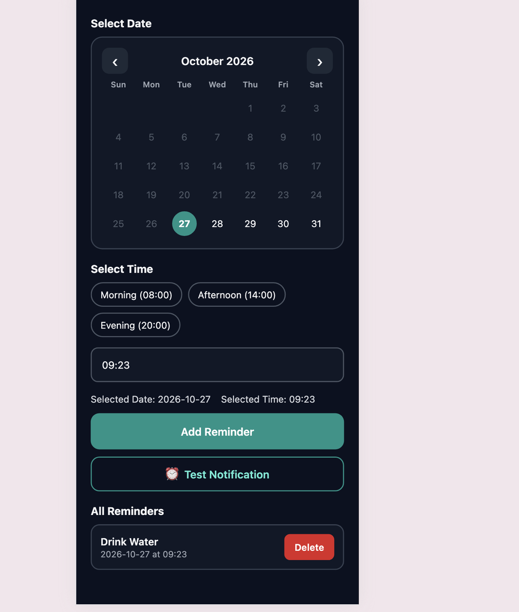
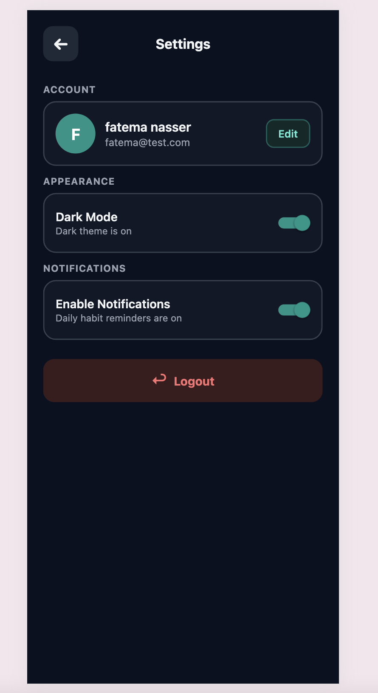
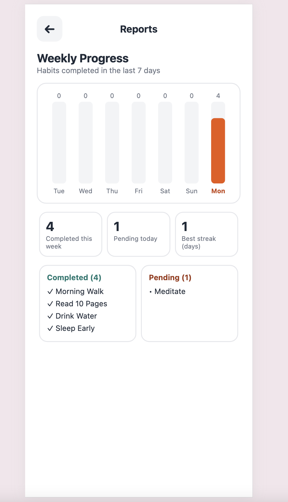
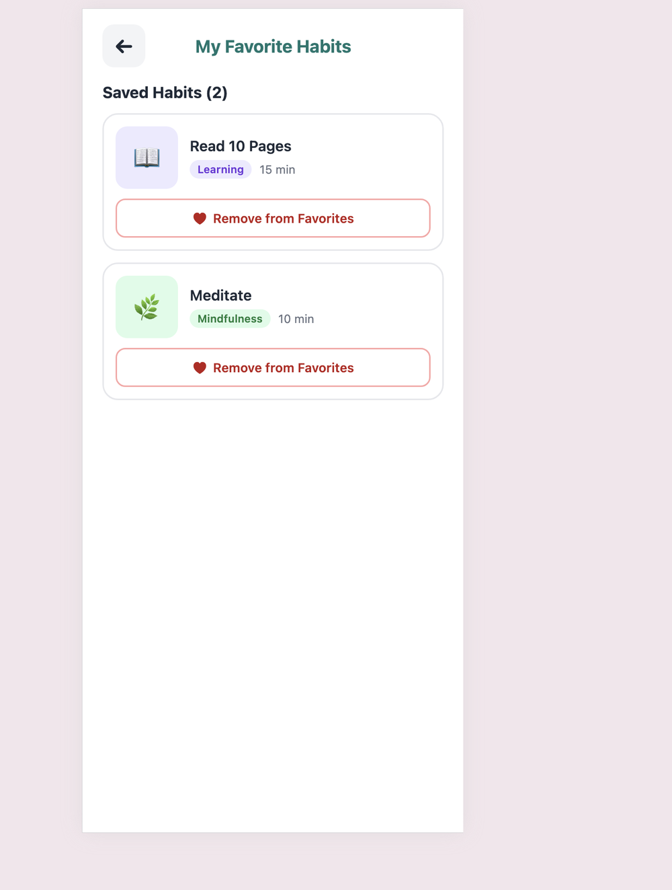

# HabitTracker – Build Better Habits, One Day at a Time

<p align="center">
  
</p>

HabitTracker is a React Native (Expo) mobile app that helps people build good habits, track their daily progress and stay motivated with daily quotes and reminders.

This file is the **marketplace listing** for the Google Play Store and the Apple App Store, prepared as part of the Mobile App Development Capstone Project.

---

## 1. App Information

| Field | Value |
|---|---|
| **App name** | HabitTracker |
| **Subtitle (App Store, 30 chars)** | Daily habits, streaks & reminders |
| **Category** | Health & Fitness (secondary: Productivity) |
| **Price** | Free |
| **Content rating** | Everyone / 4+ |
| **Platforms** | Android, iOS |
| **Version** | 1.0.0 |
| **Android package** | `com.fatemaalfaliti.habittracker` |
| **iOS bundle ID** | `com.fatemaalfaliti.habittracker` |
| **Developer** | Fatema Alfaliti |
| **Contact email** | fatemaalfaliti@gmail.com |

---

## 2. Short Description (Google Play, max 80 characters)

> Build good habits, track your daily progress and get reminders that keep you going.

---

## 3. Full Description

**Small steps every day lead to big changes.**

HabitTracker makes it simple to build the habits you want and keep them. Add your habits, tick them off each day, and watch your progress and streaks grow. A new motivational quote every morning and friendly reminders help you stay on track.

**Key features**

- ✅ **Daily habit tracking** – mark habits as done with one tap and see them move to your "Done" list.
- 📊 **Today's progress** – a clear progress bar shows how much of today's plan you have completed.
- 🔥 **Streaks** – see how many days in a row you have kept each habit.
- ➕ **Your own habits** – add custom habits with a category and duration, or start with ready-made ones like Morning Walk, Drink Water and Read 10 Pages.
- 💬 **Quote of the Day** – get a fresh motivational quote every day, or tap "New quote" for another one.
- ❤️ **Favorites** – save the habits that matter most and find them quickly.
- 📈 **Weekly report** – a chart of your last 7 days, your best streak and today's completed and pending habits.
- ⏰ **Daily reminders** – choose a habit, a date and a time on the calendar and get a notification when it is time.
- 🌙 **Dark mode** – easy on the eyes at night; your choice is remembered.
- 🔒 **Private by design** – your habits are stored on your device.

**Who is it for?**
Anyone who wants to drink more water, read more, exercise, sleep better or build any positive routine.

Start today. Your future self will thank you!

---

## 4. Keywords

`habit tracker`, `daily habits`, `habit builder`, `routine`, `streak`, `goals`, `self improvement`, `productivity`, `reminders`, `motivation`, `wellness`, `daily planner`

**App Store keyword field (max 100 characters):**
```
habit,tracker,routine,streak,goals,reminder,daily,motivation,productivity,wellness
```

---

## 5. Media Assets

### App icon
| Asset | File | Size |
|---|---|---|
| App icon | [`habit-tracker-app/assets/icon.png`](habit-tracker-app/assets/icon.png) | 1024 × 1024 |
| Android adaptive icon | [`habit-tracker-app/assets/adaptive-icon.png`](habit-tracker-app/assets/adaptive-icon.png) | 1024 × 1024 |
| Splash screen | [`habit-tracker-app/assets/splash-icon.png`](habit-tracker-app/assets/splash-icon.png) | 1024 × 1024 |

### Screenshots

| Home | Habit details | Daily reminders |
|---|---|---|
|  |  |  |

| Settings & dark mode | Weekly report | My favorites |
|---|---|---|
|  |  |  |

**Screenshot captions for the stores**
1. Track your habits and see today's progress at a glance
2. Learn about each habit and keep your streak going
3. Set reminders so you never miss a day
4. Make it yours – edit your profile and switch to dark mode
5. See your weekly progress and best streak
6. Save your favourite habits for quick access

### Promotional video (30 seconds, planned)
| Time | Scene |
|---|---|
| 0–5 s | Logo and tagline: "Build better habits, one day at a time" |
| 5–12 s | Home screen: ticking off habits, progress bar filling up |
| 12–18 s | Habit details: streak counter and "Add to Favorites" |
| 18–24 s | Setting a reminder on the calendar, notification appearing |
| 24–28 s | Weekly report and switching to dark mode |
| 28–30 s | "Download HabitTracker – free on Google Play and the App Store" |

---

## 6. Privacy and Compliance

- **Data collected:** name, email and habit data entered by the user.
- **Where it is stored:** only on the user's device (local storage). No data is sold or shared with third parties.
- **External service:** the app requests motivational quotes from a public quotes API; no personal data is sent.
- **Notifications:** used only for reminders the user creates; they can be turned off in Settings at any time.
- **User control:** users can edit their profile in Settings, and all data is removed when the app is uninstalled.
- **Children:** the app does not knowingly collect data from children under 13 (COPPA).
- **Privacy policy URL (placeholder):** `https://example.com/habittracker/privacy`

---

## 7. Publishing Checklist

- [x] App tested: sign up, login, home, details, favorites, reports, settings, reminders
- [x] App name, version, icon and splash screen set in `app.json`
- [x] Android `package` and iOS `bundleIdentifier` set
- [x] Notification permission explained for iOS and requested on Android
- [x] Store listing: short and full description, keywords, screenshots
- [ ] Create developer accounts (Google Play Console: $25 one-time; Apple Developer Program: $99/year)
- [ ] Build with EAS: `eas build --platform android` and `eas build --platform ios`
- [ ] Upload the builds and submit for review: `eas submit`

---

## 8. Marketing Plan

- **App Store Optimization:** use the keywords above in the title, subtitle and description; keep screenshots clear with short captions.
- **Social media:** short videos on Instagram and TikTok with hashtags such as `#HabitTracker`, `#DailyHabits`, `#SelfImprovement`, `#30DayChallenge`.
- **Launch campaign:** a "30-day habit challenge" where users share their streaks.
- **Reviews:** after a 7-day streak, politely ask users to rate the app.
- **Updates:** collect feedback and release regular updates (for example, home-screen widgets and cloud backup).

---

## 9. Project Files

- User stories: [`habitTracker_user_stories.md`](habitTracker_user_stories.md)
- App source code: [`habit-tracker-app/`](habit-tracker-app/)
- Built with React Native, Expo, React Navigation, AsyncStorage and expo-notifications
